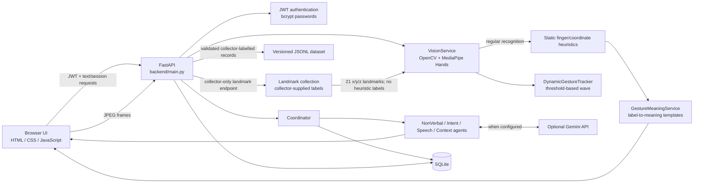

# System Architecture

## Runtime components

### Frontend

`frontend/` contains static HTML, CSS, and vanilla JavaScript. FastAPI mounts the
directory at `/app`; `/ui` redirects to the login page. The dashboard manages
authentication tokens, text and browser-supported speech input, communication
modes, webcam frame capture, conversation display, and gesture submission
stability/duplicate protection.

The frontend's verbal-to-non-verbal path presents emoji sequences. The helper
uses phrase and keyword mappings; it is not an ASL/SASL translation engine.

### FastAPI backend and authentication

`backend/main.py` creates the FastAPI application and wires routes to the
database, coordinator, gesture agent, vision service, and meaning service.
Signup hashes passwords with bcrypt. Login returns a JWT; protected routes
resolve its subject to an active user. Session APIs enforce ownership.

Dataset collection adds a separate user-ID allowlist through
`GESTURE_DATASET_COLLECTOR_IDS`. An empty list denies access. This is a
collection-specific allowlist, not a general application role system.

### MediaPipe hand detection and landmarks

`VisionService` initializes MediaPipe Hands for up to two hands. The regular
`process_frame` path decodes a JPEG/base64 frame with OpenCV, converts BGR to
RGB, obtains MediaPipe hand landmarks and handedness, then invokes the current
heuristic labeler.

The separate `extract_hand_landmarks` path used by the dataset collector
serializes all 21 landmarks as x/y/z coordinates with handedness, handedness
confidence, and capture timestamps. It does not call `_recognize_gesture`.
Landmark collection does not save raw video.

### Current heuristic gesture recognition

Static labels are assigned by `_recognize_gesture` using finger extension
comparisons, image-coordinate relationships, and fixed distances. The output
confidence exposed by the current service is based on MediaPipe handedness,
not a trained gesture-class probability.

`DynamicGestureTracker` keeps bounded timestamped movement histories by camera
stream and handedness. A wave is inferred from repeated horizontal
alternations/displacement/speed while the static pose is open-palm or raised
hand. These thresholds and its formula-derived confidence are heuristic; this
is not a temporal machine-learning model.

### Gesture interpretation

`GestureMeaningService` maps recognized labels to predefined possible meanings,
message text, and response templates. It is a mapping layer and does not
validate the user's intended meaning. Responses can be ambiguous and are not
linguistic sign interpretation.

### Conversation workflow and external AI

The dashboard starts a simulation session and sends messages to the simulation
step API. `Coordinator` orchestrates:

1. `NonVerbalAgent` token interpretation.
2. `IntentAgent` intent detection and optional context retry.
3. `SpeechAgent` response generation.
4. `ContextAgent` conversation context update.
5. Message and agent-log persistence.

Agent services use `GeminiClient` when a key and the dependency are available.
If the key is absent, initialization fails, or a request fails, individual
agents use rule-based or template fallback behavior. Gemini is optional, and
responses should not be presented as guaranteed or independently verified.

Text-to-emoji output is handled separately by `GestureAgent`: exact phrase and
keyword mappings are preferred; complex text may use Gemini; a generic emoji
fallback is returned if that is unavailable. This output is symbolic emoji,
not performed or validated signs.

### SQLite persistence

`backend/database/db.py` creates and accesses SQLite tables for users, sessions,
messages, logs, credits, subscriptions, gestures, phrases, and gesture
sequences. The default local database path is
`data/communication_bridge.db`, configurable by `DATABASE_PATH`. There is no
configured managed database service in the repository.

The separate gesture training dataset is an append-only versioned JSONL file,
by default `data/gesture_dataset_v1.jsonl`. It is not stored in SQLite and is
ignored by Git. Exported train/validation/test files are also ignored.

## Architecture diagram

## Main API routes

The implemented route list is maintained in [API.md](API.md). Principal flows
include `/auth/*`, `/simulate/*`, `/communicate`, `/translate/text-to-gesture`,
`/vision/process-frame`, `/vision/interpret-gesture`, and the allowlisted
`/vision/collection-config`, `/vision/collect-frame`, and
`/vision/dataset/recordings`.
